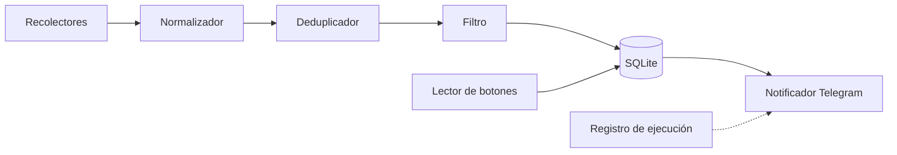

# Radar de Empleo Junior en Google Ads

**Documento de diseño · v1.0 · 5 de noviembre de 2026**

| | |
|---|---|
| **Tipo de proyecto** | Herramienta personal de automatización · Pieza de portafolio |
| **Pila técnica** | Python 3.12 · SQLite · Telegram Bot API · GitHub Actions |
| **Estado** | Diseño aprobado para el prototipo; las fuentes están pendientes de validar |

---

## 1. Resumen

El Radar de Empleo es un bot que busca ofertas de empleo junior en publicidad de búsqueda (Google Ads, SEM, PPC) dentro del mercado hispanohablante. Evalúa cada oferta frente a un perfil definido y envía a Telegram solo las que merecen atención.

El valor del proyecto está en **filtrar**, no en recolectar. Cada aviso que llega debe valer el tiempo de leerlo.

## 2. Problema y objetivo

**Problema.** Las ofertas junior de Google Ads están dispersas en varios portales, mezcladas con puestos senior y con roles de "paid media" que no incluyen búsqueda. Además, muchas dicen "remoto" sin aclarar desde qué países se puede trabajar. Revisarlas a mano lleva tiempo y es fácil que se escape alguna.

**Objetivo.** Recibir un resumen diario en Telegram con las ofertas nuevas y relevantes, cada una clasificada y con el motivo de su clasificación.

**Objetivo secundario.** Documentar el proyecto como un caso de estudio con resultados medidos, que muestre a la vez criterio de publicidad digital y capacidad de automatización.

## 3. Alcance

### Incluido

- Recolectar ofertas de dos fuentes en la primera versión y ampliar después.
- Normalizar los datos y eliminar duplicados entre portales.
- Clasificar con reglas transparentes: 🟢 buen encaje, 🟡 para revisar, 🔴 descartada.
- Enviar un resumen diario a un chat privado de Telegram.
- Registrar las acciones del usuario (guardar o descartar) como medida de la calidad del filtro.

### Fuera del alcance de la primera versión

- Postularse automáticamente a las ofertas.
- Clasificar con IA. Se evaluará en la etapa 3, cuando haya ejemplos etiquetados para medir si mejora el filtro.
- Ofrecer el servicio a otros usuarios.
- Extraer datos de portales que lo prohíben en sus condiciones de uso.

### Criterios de fracaso

El proyecto fracasa, aunque funcione técnicamente, si:

- envía tantos avisos irrelevantes que se terminan ignorando;
- una fuente que falla en silencio se confunde con "hoy no hubo ofertas";
- depende de prácticas que violan las condiciones de uso de una plataforma.

## 4. Perfil de búsqueda

| Criterio | Valor inicial | Configurable |
|---|---|---|
| Especialidad | Google Ads, SEM, PPC, publicidad de búsqueda | Sí |
| Nivel | Trainee, pasante, junior, asistente; hasta 2 años de experiencia | Sí |
| Idioma de trabajo | Español | No |
| Mercados objetivo | Todos los países hispanohablantes excepto Estados Unidos: España, México, Argentina, Colombia, Perú, Chile, Uruguay, Paraguay, Bolivia, Ecuador, Venezuela, Guatemala, Honduras, El Salvador, Nicaragua, Costa Rica, Panamá, Cuba, República Dominicana y Guinea Ecuatorial | Sí |
| País base (ciudadanía, residencia legal y cuenta bancaria) | Argentina | Sí |
| Modalidad | Remoto como prioridad; presencial o híbrido según la ciudad | Sí |
| Países habilitados | Se registra siempre; si falta, se marca "sin especificar" | — |
| Frecuencia del aviso | Un resumen diario | Sí |

> **Nota.** Una oferta en español o que diga "remoto" no implica que se pueda trabajar desde cualquier país. El bot extrae esa condición de forma explícita y nunca la supone.

## 5. Fuentes de ofertas

La utilidad del proyecto depende de esta sección, así que se valida antes de programar.

| Fuente | Vía de acceso | Cobertura esperada | Prioridad |
|---|---|---|---|
| Alertas por correo de portales regionales: LinkedIn, Indeed, Computrabajo (casi toda Latinoamérica) | Lectura de Gmail mediante la API oficial con OAuth | Amplia; abarca los portales que no permiten extracción automatizada | **Alta** |
| Alertas por correo de portales nacionales: Bumeran y ZonaJobs (Argentina), OCC Mundial (México), elempleo (Colombia), Laborum (Chile), Multitrabajos (Ecuador), Buscojobs (Uruguay), InfoJobs (España) | Igual que la fila anterior | Cubre cada mercado principal | Alta; se eligen en la etapa 0 |
| InfoJobs | API oficial | España | Alta si el mercado objetivo incluye España |
| Get on Board | API pública | Latinoamérica; pocas ofertas de marketing | Media |
| Google Jobs | SerpAPI u otro servicio similar (plan gratuito limitado) | Agrega muchos portales | Media |
| Páginas de empleo de agencias | RSS o páginas que permitan consulta automatizada | Puntual | Baja (etapa 3) |
| Remotive | API pública | Mayormente anglosajona; poco aporte para este nicho | Descartada por ahora |

**Regla.** Solo se usan APIs oficiales, RSS, correos recibidos por el usuario o páginas cuyas condiciones de uso lo permitan.

### Validación previa (etapa 0)

1. Configurar alertas guardadas en los portales elegidos durante una o dos semanas.
2. Reunir unas 30 ofertas reales de las fuentes candidatas.
3. Etiquetarlas a mano como relevantes o no relevantes.
4. Elegir las dos fuentes con más ofertas relevantes. Estas 30 ofertas pasan a ser el **conjunto de prueba** del filtro.

## 6. Filtro y clasificación

### Señales

| Tipo | Términos (sin distinguir mayúsculas ni acentos) | Efecto |
|---|---|---|
| Especialidad fuerte | Google Ads, AdWords, SEM, PPC, paid search, búsqueda pagada | Requisito para 🟢 |
| Especialidad débil | Paid media, performance, publicidad digital, medios pagos | Cuenta como especialidad solo si la descripción también menciona Google Ads |
| Nivel inicial | Junior, jr, trainee, pasante, prácticas, asistente, sin experiencia, primer empleo | Requisito para 🟢 |
| Experiencia afín | Campañas, palabras clave, conversiones, pujas, GA4, Merchant Center | Suma puntos y aparece en el motivo |
| Descarte | Senior, sr, lead, head, director, gerente, responsable de equipo (solo en el **título**: la descripción suele nombrar a otros puestos, como "reportarás al Head of Marketing"); más años de experiencia que el máximo del perfil | Envía a 🔴 |

### Reglas

- 🟢 **Buen encaje:** especialidad fuerte y nivel inicial explícitos, sin señales de descarte.
- 🟡 **Para revisar:** especialidad adecuada, pero la experiencia, la ubicación o los países habilitados no están claros; o la oferta exige residir en un país distinto del país base.

**Regla de país (país base: Argentina).** Una oferta encaja por ubicación si se puede tomar desde Argentina: presencial o remota en Argentina, o remota abierta a Latinoamérica, a todo el mundo o a contratistas internacionales. Si exige residir en otro país (por ejemplo, "solo residentes en España"), pasa a 🟡 y el motivo lo indica.
- 🔴 **Descartada:** alguna señal de descarte, o ninguna señal de especialidad.

Cada oferta guarda el **motivo** de su clasificación (por ejemplo, "SEM + junior; país sin especificar"). Ese motivo aparece en el aviso y permite revisar el criterio del filtro.

Las ofertas 🔴 no se notifican, pero se guardan para medir falsos negativos.

## 7. Notificaciones en Telegram

### Formato del aviso

```
🟢 SEM Junior — Agencia Ejemplo

🌍 Remoto · Solo residentes en España
🧩 Google Ads · GA4 · Informes
🎓 Experiencia: 0–1 año
💰 Salario: no publicado

Por qué encaja: puesto junior con gestión de campañas de búsqueda.

[ Ver oferta ]  [ ⭐ Guardar ]  [ ✖ Descartar ]
```

*(Datos ilustrativos)*

- Se envía un mensaje de cabecera con el resumen del día ("4 nuevas: 2 🟢 · 2 🟡") y después una oferta por mensaje.
- Si no hay ofertas nuevas, se envía igual un aviso breve, para que el silencio nunca resulte ambiguo.
- Si una fuente falla, la cabecera lo indica ("⚠ InfoJobs no respondió").

### Procesamiento de los botones

El bot no está encendido de forma permanente: se ejecuta según una programación. Por eso, las pulsaciones de "Guardar" y "Descartar" se procesan **en la siguiente ejecución**, leyéndolas con `getUpdates`.

- Telegram conserva las actualizaciones pendientes durante unas 24 horas, así que el intervalo entre ejecuciones debe ser menor: se programa **cada 12 horas** y solo una de esas ejecuciones envía el resumen.
- Cada pulsación se registra en la base de datos y alimenta las métricas (sección 11).
- Requisito previo: el usuario debe iniciar la conversación con el bot (`/start`) para que este pueda escribirle en privado.

## 8. Arquitectura



| Módulo | Responsabilidad |
|---|---|
| `collectors/` | Un recolector por fuente, todos con la misma interfaz: `fetch() -> list[RawJob]` |
| `normalizer.py` | Unifica título, empresa, ubicación, modalidad, países, experiencia, salario, enlace y fecha |
| `dedup.py` | Calcula una huella a partir del título y la empresa normalizados para detectar la misma oferta publicada en varios portales |
| `classifier.py` | Aplica las reglas de la sección 6 y devuelve la clasificación, el puntaje y el motivo |
| `storage.py` | Acceso a SQLite |
| `notifier.py` | Arma los mensajes y los envía con la Bot API |
| `feedback.py` | Lee las pulsaciones pendientes y actualiza el estado de cada oferta |
| `config.yaml` | Perfil de búsqueda, términos, fuentes activas y horario |

### Modelo de datos

**`ofertas`**: `id`, `fuente`, `id_externo`, `url`, `titulo`, `empresa`, `ubicacion`, `modalidad`, `paises_habilitados`, `experiencia`, `salario`, `descripcion`, `huella`, `clasificacion`, `puntaje`, `motivo`, `detectada_en`, `notificada_en`, `accion_usuario`, `accion_en`

**`ejecuciones`**: `id`, `inicio`, `fin`, `fuente`, `estado` (ok / error), `leidas`, `nuevas`, `duplicadas`, `error`

## 9. Ejecución e infraestructura

- **Programación:** GitHub Actions con `cron` cada 12 horas. No tiene costo y deja el historial de ejecuciones visible en el repositorio.
- **Persistencia:** las máquinas de GitHub Actions se borran después de cada ejecución. La base SQLite se guarda en una rama `datos` del repositorio, haciendo un *commit* al final de cada ejecución. Como alternativa, si el repositorio crece demasiado, se puede usar una base SQLite alojada (por ejemplo, Turso).
- **Secretos:** el token del bot, el ID del chat, las credenciales OAuth de Gmail y las claves de API se guardan en *GitHub Secrets*. Nunca se suben al código.
- **Privacidad:** la base solo contiene datos públicos de las ofertas. Los correos completos no se almacenan; solo se extraen los datos de cada oferta.

## 10. Manejo de errores

- Cada recolector se ejecuta de forma aislada: si una fuente falla, las demás siguen.
- Cada fuente registra su estado en `ejecuciones`, lo que distingue "falló" de "no hubo ofertas".
- Si una fuente falla tres veces seguidas, se envía un aviso específico a Telegram.
- Las solicitudes respetan los límites de cada API y se reintentan con espera creciente.

## 11. Métricas

Las métricas salen del uso normal del bot y son la base del caso de estudio.

| Métrica | Cálculo |
|---|---|
| Ofertas revisadas | Total recolectado por fuente |
| Duplicados evitados | Ofertas descartadas por huella repetida |
| Precisión del 🟢 | Guardadas ÷ notificadas como 🟢 |
| Ruido | Descartadas ÷ notificadas |
| Aporte por fuente | Ofertas 🟢 + 🟡 por fuente |
| Precisión sobre el conjunto de prueba | Acierto del filtro sobre las 30 ofertas etiquetadas en la etapa 0 |

Las cifras se obtienen durante el uso real. El documento no anticipa ningún resultado.

## 12. Hoja de ruta

| Etapa | Entregable | Criterio de cierre |
|---|---|---|
| **0 · Validación** | 30 ofertas reales etiquetadas y dos fuentes elegidas | Las fuentes elegidas aportan ofertas relevantes de forma regular |
| **1 · Prototipo** | Una fuente, filtro por reglas, SQLite y aviso a Telegram ejecutado a mano | Llega a Telegram un aviso real y correctamente clasificado |
| **2 · Versión útil** | Segunda fuente, deduplicación, ejecución programada, botones y resumen diario | Dos semanas de funcionamiento sin intervención manual |
| **3 · Versión de portafolio** | Configuración editable, una pequeña página de resultados, métricas y evaluación de un clasificador con IA comparado con las reglas | El caso de estudio está publicado con cifras reales |

## 13. Riesgos

| Riesgo | Impacto | Mitigación |
|---|---|---|
| Pocas ofertas en el nicho | El bot parece inútil | La etapa 0 lo mide antes de programar; se pueden sumar términos afines |
| Un portal cambia el formato de sus correos de alerta | Ese recolector deja de funcionar | Pruebas con correos de ejemplo guardados y alerta tras tres fallos seguidos |
| Expira el token de Gmail | Se corta la fuente principal | Aviso en Telegram al detectar el error de autenticación |
| Las reglas descartan ofertas buenas | Se pierden oportunidades | Se revisan las 🔴 periódicamente y se compara con el conjunto de prueba |
| La rama `datos` crece demasiado | El repositorio se vuelve pesado | Limpieza de ofertas con más de 90 días o migración a una base alojada |

## 14. Decisiones pendientes

1. ~~Mercados objetivo~~ **Resuelto:** todos los países hispanohablantes excepto Estados Unidos (ver sección 4). Puerto Rico queda excluido junto con Estados Unidos; es una decisión provisional y se puede cambiar en la configuración.
2. ~~País de residencia del usuario~~ **Resuelto:** el país base es Argentina, por ciudadanía y cuenta bancaria (ver la regla de país en la sección 6).
3. **Portales que el usuario usa hoy.** Define las alertas por correo de la etapa 0.
4. **Ciudad para puestos presenciales o híbridos**, si se aceptan.

Los requisitos detallados de cada parte están en [requisitos-radar-empleo.md](requisitos-radar-empleo.md).

## 15. Presentación en el portafolio

El repositorio público es la pieza principal. Su README funciona como caso de estudio:

1. **El problema**, en un párrafo y con la necesidad real.
2. **La solución**, con el diagrama de arquitectura.
3. **Una demostración**: un GIF o video corto con un aviso real llegando a Telegram.
4. **Las decisiones de criterio**: por qué reglas antes que IA, por qué alertas por correo en lugar de extraer datos de los portales.
5. **Los resultados medidos** (sección 11).
6. **Los aprendizajes y los próximos pasos.**
